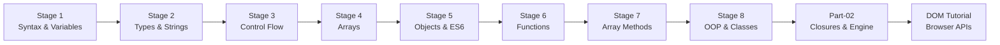

# JavaScript Programming Learning

**A structured, hands-on roadmap from JavaScript fundamentals through ES6+, closures, prototypes, classes, and DOM manipulation.**

[](https://developer.mozilla.org/en-US/docs/Web/JavaScript)
[](https://nodejs.org/)
[](./DOM%20Tutorial)
[](./.github/workflows/ci.yml)
[](./LICENSE)

[About](#about) · [Quick Start](#quick-start) · [Roadmap](#learning-roadmap) · [Concepts Index](#key-concepts-index) · [Module Reference](#module-reference) · [Best Practices](#best-practices)

</div>

---

## About

This repository is a **complete JavaScript learning archive** organized into three modules. It progresses from `console.log("Hello World")` through modern ES6+ features—destructuring, spread/rest, optional chaining, `Map`/`Set`, prototypes, and classes—and finishes with **browser DOM** projects and **engine internals** (hoisting, execution context, closures).

| Attribute | Detail |
|---|---|
| **Repository** | [isinghabhishek/javascript-programming-learning](https://github.com/isinghabhishek/javascript-programming-learning) |
| **Default branch** | `master` |
| **Modules** | 3 — [JavaScript Part-01](./JavaScript%20Part-01), [JavaScript Part-02](./JavaScript%20Part-02), [DOM Tutorial](./DOM%20Tutorial) |
| **JavaScript files** | **102** (90 + 11 + 1 stub) |
| **HTML demos** | 3 (`index.html` in Part-01, Part-02, and DOM Tutorial) |
| **Linting** | [`.eslintrc.json`](./.eslintrc.json) — browser + ES2021 environment |
| **CI** | ESLint on all `.js` files + html-validate on all `.html` files |

Files are numbered sequentially within each part (`01file.js` → `90StaticMethodsAndProperties.js`) so you can follow the curriculum in order. Many files include interview notes using comment tags (`// INFO:`, `// HACK:`, `// BUG:`).

### How the three modules relate

| Module | Role | Run with |
|---|---|---|
| [JavaScript Part-01](./JavaScript%20Part-01) | Core language + ES6+ + OOP | **Node.js** or browser via `index.html` |
| [JavaScript Part-02](./JavaScript%20Part-02) | Engine behavior — hoisting, scope chain, closures | **Node.js** or browser via `index.html` |
| [DOM Tutorial](./DOM%20Tutorial) | Real webpage — navigation, todo form, signup form | **Browser only** (open `index.html`) |

---

## Quick Start

### Prerequisites

- **Node.js 18+** (CI uses Node 20) for running `.js` files in the terminal
- A modern browser (Chrome, Firefox, Edge) for DOM Tutorial and `index.html` demos
- Optional: VS Code with ESLint extension

```bash
node -v    # v18+ recommended
npm -v
```

### Clone the repository

```bash
git clone https://github.com/isinghabhishek/javascript-programming-learning.git
cd javascript-programming-learning
```

### Run a single script with Node.js

```bash
# Part-01 — fundamentals
node "JavaScript Part-01/01file.js"

# Part-01 — closures preview (also covered deeply in Part-02)
node "JavaScript Part-01/46LexicalScope.js"

# Part-02 — closures
node "JavaScript Part-02/08Closures.js"
```

**Windows PowerShell** — use the same commands; quote paths that contain spaces.

### Run in the browser (Part-01 / Part-02)

Each part includes an `index.html` that links script files. Open the HTML file and **uncomment exactly one** `<script>` tag at a time to load the lesson you are studying:

```bash
# Example: open Part-01 demo page
start "JavaScript Part-01/index.html"    # Windows
open "JavaScript Part-01/index.html"     # macOS
xdg-open "JavaScript Part-01/index.html" # Linux
```

### Run the DOM project

```bash
# Open the full DOM tutorial (HTML + CSS + assets)
start "DOM Tutorial/index.html"
```

The DOM project is a multi-section landing page with navigation, a todo input form, and a signup form — styled with [DOM Tutorial/style.css](./DOM%20Tutorial/style.css).

### Lint locally (same as CI)

```bash
npm install --save-dev eslint@8 html-validate
npx eslint "**/*.js"
npx html-validate "**/*.html"
```

---

## Learning Roadmap

Eight stages across Part-01, plus two advanced modules (Part-02 and DOM). Follow file numbers in order within [JavaScript Part-01](./JavaScript%20Part-01).



---

### Stage 1 — Syntax, Variables, and Comments

| Files | Topics |
|---|---|
| `01file.js` – `04constants.js` | Hello World, `var`/`let`/`const`, single & multi-line comments, interview Q&A on `+` coercion |

**Key skills:** Running scripts with Node, reading console output, understanding `let` vs `const`.

---

### Stage 2 — Strings, Types, and Operators

| Files | Topics |
|---|---|
| `05string.js` – `11.js` | String methods (`trim`, `slice`, `toUpperCase`), `typeof`, `undefined`/`null`/`BigInt`, `==` vs `===`, booleans |

**Key skills:** Primitive vs reference intuition, loose vs strict equality (common interview topic).

---

### Stage 3 — Conditionals and Loops

| Files | Topics |
|---|---|
| `12ifElse.js` – `23doWhile.js` | `if/else`, falsy/truthy values, ternary, `&&`/`||`, nested if, `switch`, `while`, `for`, `break`/`continue`, `do-while` |

**Key skills:** Truthy/falsy table, short-circuit evaluation, loop selection.

---

### Stage 4 — Arrays and Iteration

| Files | Topics |
|---|---|
| `24Arrays.js` – `33ArrDestructuring.js` | Array CRUD, `push`/`pop`/`shift`/`unshift`, cloning, `for`/`while` on arrays, `for...of`, `for...in`, **array destructuring** |

**Key skills:** Shallow copy pitfalls, iterating arrays vs objects.

---

### Stage 5 — Objects and ES6 Object Syntax

| Files | Topics |
|---|---|
| `34Object.js` – `41NestedDestructuring.js` | Object literals, dot vs bracket notation, iteration, computed properties, **spread operator**, object destructuring, nested structures |

**Key skills:** Object references, spread for cloning, destructuring function parameters.

---

### Stage 6 — Functions, Scope, and Callbacks

| Files | Topics |
|---|---|
| `42Function.js` – `52FuncReturnFunc.js` | Function declarations/expressions, arrow functions, hoisting, nested functions, lexical scope, block vs function scope, default/rest params, destructuring params, callbacks, higher-order functions |

**Key skills:** Arrow vs regular `this` (preview), passing functions as values.

---

### Stage 7 — Functional Array Methods and Modern Collections

| Files | Topics |
|---|---|
| `53ArrayMethod.js` – `68OptionalChaining.js` | `forEach`, `map`, `filter`, `reduce`, `sort`, `find`, `every`, `some`, `fill`, `splice`, iterables, `Set`, `Map`, `Object.assign`, **optional chaining (`?.`)** |

**Key skills:** Declarative array transforms, when to use `Map`/`Set` over plain objects/arrays.

---

### Stage 8 — `this`, Prototypes, and Classes

| Files | Topics |
|---|---|
| `69Methods.js` – `90StaticMethodsAndProperties.js` | Object methods, `this` in window/object, `call`/`apply`/`bind`, arrow functions & `this`, factory functions, `__proto__`/`Object.create`, prototype chain, `new` keyword, ES6 `class`, `extends`, `super`, getters/setters, static members |

**Key skills:** Prototype-based OOP, class syntactic sugar, interview questions on `this` binding.

---

### Advanced — JavaScript Part-02 (Engine Internals)

| Files | Topics |
|---|---|
| `01CompilationandCodeExecution.js` – `11ClosuresEx04.js` | Compilation vs execution phases, temporal dead zone, function declaration hoisting, `var` in functions, execution context, lexical environment, scope chain, **closures** (4 progressive examples) |

**Key skills:** Explaining closures in interviews, drawing scope chain diagrams.

---

### Advanced — DOM Tutorial (Browser)

| Asset | Purpose |
|---|---|
| `index.html` | Multi-section page — header/nav, hero, todo section, signup form |
| `style.css` | Responsive layout, Google Fonts, background images |
| `DOM.js` | Placeholder stub — DOM scripts are intended to be added here or inline |
| `bgpexels.jpg` / `bgpexels1.jpg` | Hero background images |

**Key skills:** Linking scripts with `defer`, DOM selection, events, dynamic styling.

---

## Key Concepts Index

Quick lookup for important JavaScript concepts and where they are implemented.

| Concept | Module | File(s) | Notes |
|---|---|---|---|
| Hello World & comments | Part-01 | `01file.js` | Interview notes on `10+20+"30"` coercion |
| `let` vs `const` vs `var` | Part-01 | `02variable.js`, `03let.js`, `04constants.js` | Block scoping introduction |
| Template literals | Part-01 | `09temlateStr.js` | ES6 string interpolation |
| `==` vs `===` | Part-01 | `11.js` | Loose vs strict equality |
| Falsy / truthy | Part-01 | `13falsy.js`, `14truthy.js` | Conditional short-circuiting |
| Array destructuring | Part-01 | `33ArrDestructuring.js` | ES6 syntax |
| Spread operator | Part-01 | `38SpreadOperator.js` | Arrays and objects |
| Arrow functions | Part-01 | `43ArrowFunction.js` | Lexical `this` |
| Hoisting | Part-01 / Part-02 | `44Hoisting.js`, `02whatHappToFuncDeclaration.js` | Part-02 goes deeper |
| Lexical scope | Part-01 / Part-02 | `46LexicalScope.js`, `07LexicalEnviormntAndScopeChain.js` | Scope chain |
| Callbacks | Part-01 | `51CallBackFunc.js` | Functions as arguments |
| `map` / `filter` / `reduce` | Part-01 | `54MapMethod.js`, `55FilterMethod.js`, `56ReduceMethod.js` | Functional array methods |
| `Set` and `Map` | Part-01 | `65Sets.js`, `66MapsObject.js` | ES6 collections |
| Optional chaining | Part-01 | `68OptionalChaining.js` | Safe property access `?.` |
| `call` / `apply` / `bind` | Part-01 | `71CallApplyBindMethods.js` | Explicit `this` binding |
| `Object.create` & `__proto__` | Part-01 | `78.js`, `79Prototype.js` | Prototype chain |
| ES6 `class` | Part-01 | `85ClassKeywoard.js` | Syntactic sugar over prototypes |
| `extends` / `super` | Part-01 | `86Class&ExtendsKeywoard.js`, `87SuperKeywoard.js` | Inheritance |
| Getters / setters | Part-01 | `89Getter&Setters.js` | Accessor properties |
| Static methods | Part-01 | `90StaticMethodsAndProperties.js` | Class-level members |
| Execution context | Part-02 | `06FunctionExecutionContext.js` | How JS runs functions |
| **Closures** | Part-02 | `08Closures.js` – `11ClosuresEx04.js` | Four worked examples |
| DOM + CSS layout | DOM Tutorial | `index.html`, `style.css` | Real multi-section webpage |

---

## Module Reference

Expand each module for a **complete file-by-file breakdown**.

<details>
<summary><strong>JavaScript Part-01</strong> — 90 files + index.html</summary>

#### Files 01–11: Syntax, types, and operators

| File | Topic |
|---|---|
| `01file.js` | Hello World, comment types, string coercion interview questions |
| `02variable.js` | `var` — redeclaration and scope basics |
| `03let.js` | `let` — block scope |
| `04constants.js` | `const` — constants and immutability |
| `05string.js` | String creation and basics |
| `06.js` | String methods: `trim`, `toUpperCase`, `toLowerCase`, `slice` |
| `07typeof.js` | `typeof` operator |
| `08strConcatenation.js` | String concatenation with `+` |
| `09temlateStr.js` | Template literals (backticks) |
| `10.js` | `undefined`, `null`, `BigInt` |
| `11.js` | Booleans, `==` vs `===`, `!=` vs `!==` |

#### Files 12–23: Control flow

| File | Topic |
|---|---|
| `12ifElse.js` | `if` / `else` |
| `13falsy.js` | Falsy values |
| `14truthy.js` | Truthy values |
| `15ternary.js` | Ternary operator |
| `16AndOr.js` | Logical `&&` and `||` |
| `17nestedIfElse.js` | Nested conditionals |
| `18IfElseIf.js` | `if` / `else if` ladder |
| `19switch.js` | `switch` statement |
| `20While.js` | `while` loop |
| `21ForLoop.js` | `for` loop |
| `22BreakContinue.js` | `break` and `continue` |
| `23doWhile.js` | `do-while` loop |

#### Files 24–33: Arrays and iteration

| File | Topic |
|---|---|
| `24Arrays.js` | Array creation and indexing |
| `25ArrayMethod.js` | Basic array methods |
| `26PrimtvVSrefensDataType.js` | Primitives vs reference types |
| `27ArrayClone.js` | Cloning arrays (shallow copy) |
| `28ArrayForLoop.js` | Iterating arrays with `for` |
| `29ConstArray.js` | `const` with arrays |
| `30ArrayWhileLoop.js` | Iterating with `while` |
| `31ForOf.js` | `for...of` loop |
| `32ForIn.js` | `for...in` loop |
| `33ArrDestructuring.js` | Array destructuring |

#### Files 34–41: Objects and ES6 object features

| File | Topic |
|---|---|
| `34Object.js` | Object literals and properties |
| `35dot&Bracket.js` | Dot vs bracket notation |
| `36iterateObject.js` | Iterating object keys/values |
| `37computed.js` | Computed property names |
| `38SpreadOperator.js` | Spread operator for arrays and objects |
| `39ObjectDestructuring.js` | Object destructuring |
| `40ObjectInsideArray.js` | Array of objects |
| `41NestedDestructuring.js` | Nested destructuring |

#### Files 42–52: Functions and scope

| File | Topic |
|---|---|
| `42Function.js` | Function declarations and expressions |
| `43ArrowFunction.js` | Arrow function syntax |
| `44Hoisting.js` | Variable and function hoisting |
| `45FunctionINfunction.js` | Nested functions |
| `46LexicalScope.js` | Lexical scoping |
| `47BlockVsFuncScope.js` | Block scope vs function scope |
| `48DefaultParameter.js` | Default parameters |
| `49RestParameter.js` | Rest parameters (`...args`) |
| `50ParamDestructuring.js` | Destructuring in parameters |
| `51CallBackFunc.js` | Callback functions |
| `52FuncReturnFunc.js` | Functions returning functions |

#### Files 53–68: Array methods and modern collections

| File | Topic |
|---|---|
| `53ArrayMethod.js` | `forEach` |
| `54MapMethod.js` | `map` |
| `55FilterMethod.js` | `filter` |
| `56ReduceMethod.js` | `reduce` |
| `57SortMethod.js` | `sort` (including custom comparators) |
| `58FindMethod.js` | `find` |
| `59EveryMethod.js` | `every` |
| `60SomeMethod.js` | `some` |
| `61FillMethod.js` | `fill` |
| `62SpliceMethod.js` | `splice` |
| `63Iterables.js` | Iterables and iterators |
| `64ArrayLikeObjects.js` | Array-like objects (e.g. `arguments`) |
| `65Sets.js` | `Set` data structure |
| `66MapsObject.js` | `Map` data structure |
| `67CloneObjAssign.js` | Cloning with `Object.assign` |
| `68OptionalChaining.js` | Optional chaining (`?.`) |

#### Files 69–90: `this`, prototypes, and classes

| File | Topic |
|---|---|
| `69Methods.js` | Methods in objects |
| `70ThisWindow.js` | `this` in global/window context |
| `71CallApplyBindMethods.js` | `call`, `apply`, `bind` |
| `72SmallWarning.js` | Common `this` pitfalls |
| `73ArrowFunction&This.js` | Arrow functions and lexical `this` |
| `74ShortSyntax.js` | Object method shorthand |
| `75CreateFunctionsToCreateMultipleObjects.js` | Factory functions |
| `76Extended75.js` | Factory pattern extension |
| `77Extended76.js` | Further factory refinement |
| `78.js` | `Object.create`, `__proto__`, `[[prototype]]` |
| `79Prototype.js` | Prototype object |
| `80UsePrototype.js` | Using prototypes for shared methods |
| `81newKeywoard.js` | `new` keyword and constructor behavior |
| `82NewKeyword80Extnstion.js` | Extended `new` / constructor example |
| `83.js` | Prototype chain continuation |
| `84MoreAboutPrototype.js` | Additional prototype patterns |
| `85ClassKeywoard.js` | ES6 `class` syntax |
| `86Class&ExtendsKeywoard.js` | Class inheritance with `extends` |
| `87SuperKeywoard.js` | `super` keyword |
| `88BaseClass.js` | Base class patterns |
| `89Getter&Setters.js` | Getters and setters |
| `90StaticMethodsAndProperties.js` | `static` methods and properties |

**Browser demo:** [JavaScript Part-01/index.html](./JavaScript%20Part-01/index.html) — uncomment one `<script>` tag per lesson.

</details>

<details>
<summary><strong>JavaScript Part-02</strong> — 11 files + index.html</summary>

| File | Topic |
|---|---|
| `01CompilationandCodeExecution.js` | How JavaScript compiles and executes code |
| `02whatHappToFuncDeclaration.js` | Hoisting of function declarations |
| `03varFunc.js` | `var` inside functions |
| `04let.js` | `let` and temporal dead zone |
| `05hjw.js` | Hoisting worked example |
| `06FunctionExecutionContext.js` | Function execution context |
| `07LexicalEnviormntAndScopeChain.js` | Lexical environment and scope chain |
| `08Closures.js` | Closures — functions returning functions |
| `09ClosuresEx02.js` | Closure example 2 |
| `10ClosuresEx03.js` | Closure example 3 |
| `11ClosuresEx04.js` | Closure example 4 |

**Browser demo:** [JavaScript Part-02/index.html](./JavaScript%20Part-02/index.html)

</details>

<details>
<summary><strong>DOM Tutorial</strong> — HTML/CSS project + assets</summary>

| File | Description |
|---|---|
| `index.html` | Landing page with nav (Home, Todo, About, Sign Up), hero section, todo input form, and signup form with validation fields |
| `style.css` | Full-page layout — flexbox nav, hero background image, form styling, Poppins font |
| `DOM.js` | Stub file (DOM logic to be implemented or added inline) |
| `bgpexels.jpg` | Background image asset |
| `bgpexels1.jpg` | Header hero background |

**How to use:** Open `index.html` in a browser. Link `DOM.js` with `<script defer src="DOM.js">` and practice `querySelector`, event listeners, and DOM manipulation on the todo and signup forms.

</details>

---

## Best Practices

### How to study this repository

1. **Follow file numbers** in Part-01 sequentially — later files assume earlier concepts.
2. **Run every file** with `node` and read the console output before moving on.
3. **Predict output first** — especially for `==` vs `===`, hoisting, and closure files.
4. **Use `index.html`** when a lesson involves `window`, `document`, or `this` in browser context.
5. **Re-solve** — close the file and rewrite the program from memory.

### JavaScript pitfalls covered in this repo

| Pitfall | Where it is demonstrated |
|---|---|
| `typeof null === "object"` | `10.js` |
| `10 + 20 + "30"` → `"3030"` | `01file.js` |
| `var` hoisting | `44Hoisting.js`, Part-02 |
| Shallow array/object clone | `27ArrayClone.js`, `67CloneObjAssign.js` |
| `this` lost in callbacks | `71CallApplyBindMethods.js`, `73ArrowFunction&This.js` |
| `sort()` without comparator | `57SortMethod.js` |

### Clean code guidelines

1. Prefer `const` by default; use `let` when reassignment is needed; avoid `var` in new code.
2. Always use `===` unless you explicitly need type coercion.
3. Use template literals instead of `+` for string building.
4. Prefer `map`/`filter`/`reduce` over manual `for` loops when transforming data.
5. Use optional chaining (`?.`) instead of nested `if` guards for deep property access.
6. Keep one concept per file — match the existing numbered convention when adding lessons.

### Debugging tips

```javascript
// Trace closure variable capture
function makeCounter() {
  let count = 0;
  return function () {
    console.log("count before:", count);
    count++;
    console.log("count after:", count);
    return count;
  };
}
```

Use `console.log` at function entry/exit (as shown above) when studying Part-02 closure files.

### Suggested study loop

```
Read comments → predict output → run with Node → modify one line → re-run → rewrite from scratch
```

---

## Repository Structure

```
javascript-programming-learning/
├── .github/workflows/ci.yml       # ESLint + html-validate on push
├── .eslintrc.json                 # ESLint config (browser, ES2021)
├── JavaScript Part-01/            # 90 lessons (01–90) + index.html
├── JavaScript Part-02/            # 11 advanced lessons + index.html
├── DOM Tutorial/                  # Browser project (HTML, CSS, images)
├── CODE_OF_CONDUCT.md
├── LICENSE                        # Apache License 2.0
└── README.md
```

---

## Continuous Integration

The workflow at [`.github/workflows/ci.yml`](./.github/workflows/ci.yml) runs on every push and pull request to `master` or `main`:

1. Checks out the repository
2. Sets up **Node.js 20**
3. Runs **ESLint** on all `**/*.js` files (using [`.eslintrc.json`](./.eslintrc.json))
4. Runs **html-validate** on all `**/*.html` files

Both lint steps use `|| true` so the workflow reports issues without hard-failing — useful while learning, but fix warnings before production code.

---

## Contributing

1. Fork the repository
2. Create a branch: `git checkout -b lesson/new-topic`
3. Add a numbered `.js` file in the correct part folder
4. Verify: `node "JavaScript Part-01/yourFile.js"` and `npx eslint yourFile.js`
5. Open a Pull Request against `master`

Follow the existing naming pattern (`NNTopicName.js`) and include brief `// NOTE:` comments for non-obvious behavior.

---

## Author

**Abhishek Singh** — [GitHub @isinghabhishek](https://github.com/isinghabhishek)

Related repository: [java_dsa](https://github.com/isinghabhishek/java_dsa) — Java Data Structures & Algorithms.

---

## License

This project is licensed under the [Apache License 2.0](./LICENSE).

---

<div align="center">

**Built while learning JavaScript — one file at a time.**

If this repository helps your journey, consider starring it on [GitHub](https://github.com/isinghabhishek/javascript-programming-learning).

</div>
